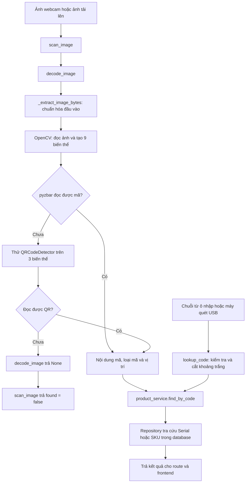

# Giải thích logic quét mã trong scanner_service.py

Tài liệu giải thích file [scanner_service.py](../backend/app/services/scanner_service.py): cách nhận dữ liệu ảnh, tạo các biến thể ảnh để hỗ trợ nhận diện, giải mã QR/barcode và tra cứu sản phẩm từ kết quả đọc được.

## 1. Vai trò của file và luồng tổng thể

Service có hai luồng sử dụng:

| Luồng | Đầu vào | Cách xử lý |
| --- | --- | --- |
| Quét ảnh qua `scan_image()` | Một khung hình webcam hoặc ảnh tải lên. | Đọc nội dung mã trong ảnh, sau đó tra cứu sản phẩm. |
| Tra cứu qua `lookup_code()` | Chuỗi mã do người dùng nhập hoặc máy quét USB đưa vào ô nhập. | Dùng ngay chuỗi đó để tra cứu sản phẩm. |

Trong luồng webcam, trình duyệt mở camera và gửi từng ảnh lên backend. File Python xử lý từng ảnh nhận được; vòng lặp chụp webcam nằm ở frontend.



Sơ đồ thể hiện luồng xử lý thông thường. Dữ liệu không đọc được có thể khiến luồng dừng sớm; lỗi thư viện hoặc database có thể phát sinh ngoại lệ.

### Các thư viện và hàm chính

| Thành phần | Vai trò |
| --- | --- |
| `base64` | Chuyển chuỗi Base64 thành dữ liệu ảnh nhị phân. |
| `re` | Nhận diện phần đầu của Data URL để tách nội dung Base64. |
| `numpy` | Biểu diễn dữ liệu byte và kernel xử lý ảnh dưới dạng mảng. |
| `cv2` | Đọc ảnh, chuyển ảnh xám, biến đổi ảnh và dùng bộ giải mã QR dự phòng. |
| `pyzbar_decode` | Hàm `decode` của pyzbar, được đổi tên khi import; dùng để nhận diện và giải mã các mã trong ảnh. |
| `product_service` | Nhận chuỗi đã đọc được để tra cứu sản phẩm qua repository. |

| Hàm | Đầu vào | Kết quả |
| --- | --- | --- |
| `_extract_image_bytes(data)` | `bytes`, `bytearray`, chuỗi Base64 hoặc Data URL. | `bytes` hoặc `None`. |
| `decode_image(image_data)` | Dữ liệu ảnh ở một trong các dạng trên. | Dictionary mô tả mã đọc được hoặc `None`. |
| `scan_image(image_data)` | Dữ liệu ảnh. | Dictionary chứa kết quả nhận diện và kết quả tra cứu sản phẩm. |
| `lookup_code(code)` | Chuỗi Serial hoặc SKU. | Dictionary chứa kết quả tra cứu. |

Các chú thích kiểu như `Optional[bytes]` nghĩa là hàm có thể trả `bytes` hoặc `None`. Đây là thông tin mô tả kiểu dữ liệu; các câu lệnh trong thân hàm mới thực hiện việc kiểm tra khi chạy.

## 2. `_extract_image_bytes()`: chuẩn hóa dữ liệu ảnh

Ảnh có thể đến từ file tải lên hoặc từ chuỗi JSON do trình duyệt gửi. Hàm này đưa các dạng đầu vào về dữ liệu nhị phân để OpenCV đọc.

### Trường hợp 1: đầu vào là `bytes` hoặc `bytearray`

```python
if isinstance(data, (bytes, bytearray)):
    return bytes(data)
```

Đây là dữ liệu ảnh nhị phân, ví dụ nội dung PNG hoặc JPEG được đọc từ file tải lên. Hàm trả về kiểu `bytes`.

### Trường hợp 2: đầu vào là chuỗi

Chuỗi được xử lý như Base64, có thể có phần đầu Data URL:

```text
Base64 thuần:  iVBORw0KGgo...
Data URL:      data:image/png;base64,iVBORw0KGgo...
```

Biểu thức sau tìm cấu trúc Data URL:

```python
match = re.match(r"^data:image/[a-zA-Z0-9.+]+;base64,(.*)$", data)
base64_str = match.group(1) if match else data
```

Nếu khớp, `group(1)` lấy phần sau dấu phẩy. Nếu không khớp, toàn bộ chuỗi được dùng làm nội dung Base64.

```python
try:
    return base64.b64decode(base64_str)
except Exception:
    return None
```

Giải mã thành công chỉ có nghĩa là nhận được các byte. OpenCV ở bước sau mới xác định các byte đó có đọc được thành ảnh hay không. Lệnh `b64decode()` hiện dùng chế độ mặc định, không bật kiểm tra Base64 nghiêm ngặt bằng `validate=True`.

### Trường hợp 3: kiểu dữ liệu khác

Các giá trị như `None`, số nguyên hoặc dictionary đi đến `return None` cuối hàm. Chuỗi đường dẫn file và URL mạng cũng không được mở hoặc tải về; mọi chuỗi đi vào nhánh giải mã Base64.

## 3. `decode_image()`: đọc dữ liệu thành ảnh OpenCV

### Bước 1: lấy dữ liệu nhị phân

```python
raw_bytes = _extract_image_bytes(image_data)
if not raw_bytes:
    return None
```

Nếu không nhận được byte hoặc kết quả là chuỗi byte rỗng, hàm dừng ngay. Database chưa được truy vấn ở bước này.

### Bước 2: đọc thành ảnh màu

```python
np_arr = np.frombuffer(raw_bytes, np.uint8)
img = cv2.imdecode(np_arr, cv2.IMREAD_COLOR)
```

`np.frombuffer()` tạo mảng số nguyên không dấu 8 bit từ các byte ảnh. Đây vẫn là dữ liệu file ảnh đã mã hóa, chưa phải ma trận pixel hoàn chỉnh.

`cv2.imdecode()` đọc mảng đó thành ma trận ảnh màu. Với OpenCV, ba kênh màu của ảnh được đọc theo thứ tự BGR.

Nếu hai lệnh phát sinh ngoại lệ, khối `except` trả `None`. Nếu không có ngoại lệ nhưng ảnh là `None` hoặc có kích thước dữ liệu bằng 0, hàm cũng trả `None`.

### Bước 3: lấy kích thước và chuyển ảnh xám

```python
h, w = img.shape[:2]
gray = cv2.cvtColor(img, cv2.COLOR_BGR2GRAY)
```

`h` là chiều cao và `w` là chiều rộng ảnh, tính bằng pixel. `gray` giữ thông tin mức sáng trên một kênh thay cho ba kênh màu, làm đầu vào cho phần lớn các phép xử lý tiếp theo.

## 4. Tạo chín biến thể để thử giải mã

Ảnh webcam có thể bị mờ, tương phản thấp, phản chiếu hoặc đặt mã theo hướng khác nhau. Hàm chuẩn bị nhiều cách biểu diễn của cùng một ảnh để thử đọc mã.

| Thứ tự | Biến thể | Lệnh hoặc tham số chính | Mục đích |
| --- | --- | --- | --- |
| 1 | Ảnh xám. | `gray` | Thử trực tiếp trên thông tin mức sáng. |
| 2 | Ảnh màu gốc. | `img` | Thử ảnh trước các phép biến đổi. |
| 3 | Cắt vùng giữa và phóng to. | Giữ 70% mỗi chiều, phóng `1.75` lần bằng `INTER_CUBIC`. | Thử vùng mã nằm giữa khung hình ở kích thước lớn hơn. |
| 4 | Lật ngang ảnh xám. | `cv2.flip(gray, 1)` | Thử ảnh theo hướng phản chiếu ngang. |
| 5 | Xoay ảnh xám. | `ROTATE_90_CLOCKWISE` | Thử hướng xoay 90 độ theo chiều kim đồng hồ. |
| 6 | Tăng tương phản cục bộ. | CLAHE, `clipLimit=2.5`, `tileGridSize=(8, 8)`. | Làm rõ khác biệt sáng/tối ở từng vùng ảnh. |
| 7 | Làm sắc nét. | `cv2.filter2D()` với kernel 3 × 3. | Nhấn mạnh biên của các vạch hoặc ô QR. |
| 8 | Phân ngưỡng đen trắng. | `THRESH_BINARY + THRESH_OTSU` | Tự chọn ngưỡng để tách pixel thành hai mức. |
| 9 | Đảo mức sáng. | `cv2.bitwise_not(gray)` | Thử mã có màu sáng/tối đảo ngược. |

### Cách cắt vùng giữa

```python
ch, cw = int(h * 0.7), int(w * 0.7)
cy, cx = (h - ch) // 2, (w - cw) // 2
crop = gray[cy:cy + ch, cx:cx + cw]
```

`ch` và `cw` là chiều cao, chiều rộng vùng cắt. `cy` và `cx` là tọa độ góc trên bên trái để vùng cắt nằm giữa ảnh.

Ví dụ với ảnh rộng 1000 pixel và cao 800 pixel, vùng cắt rộng 700 pixel, cao 560 pixel; góc bắt đầu tại `x = 150`, `y = 120`. Sau đó vùng này được phóng to `1.75` lần theo cả hai chiều.

### Cách tăng tương phản và làm sắc nét

CLAHE xử lý tương phản theo các vùng nhỏ. `tileGridSize=(8, 8)` chỉ số vùng chia theo hai chiều, không phải mỗi vùng có kích thước 8 × 8 pixel. `clipLimit` điều chỉnh giới hạn khuếch đại tương phản.

Nhánh làm sắc nét sử dụng kernel:

```text
-1  -1  -1
-1   9  -1
-1  -1  -1
```

Pixel ở giữa nhận trọng số dương lớn, còn các pixel xung quanh có trọng số âm. Cách kết hợp này làm nổi bật chênh lệch mức sáng quanh biên.

### Thứ tự tạo ảnh và thử đọc

Chương trình **tạo đủ chín biến thể trước**, sau đó mới chạy vòng lặp gọi pyzbar. Vì vậy, dù đọc được mã ngay ở ảnh xám đầu tiên, các phép tạo biến thể phía sau vẫn đã chạy.

Các nhánh lật, xoay, tăng tương phản, làm sắc nét, phân ngưỡng và đảo màu đều xuất phát từ `gray`. Chúng là các lựa chọn ảnh riêng để thử đọc, không phải một chuỗi biến đổi tích lũy lần lượt lên nhau.

Các phép biến đổi nhằm tăng cơ hội nhận diện; chúng không bảo đảm khôi phục được mọi ảnh mờ, mất chi tiết hoặc mã bị che.

## 5. Thử giải mã bằng pyzbar

```python
for cand in candidates:
    results = pyzbar_decode(cand)
```

Hàm thử từng ảnh đúng thứ tự trong bảng trên. Khi pyzbar trả về kết quả, chương trình xử lý phần tử đầu tiên:

```python
first = results[0]
```

Do đó, đầu ra của service là một mã cho mỗi lần xử lý ảnh. Nó chưa duyệt toàn bộ mã trong một ảnh hoặc lựa chọn mã gần tâm nhất. Nếu phần tử đầu tiên có nội dung rỗng sau khi cắt khoảng trắng, chương trình chuyển sang biến thể ảnh tiếp theo.

### Chuyển nội dung mã thành chuỗi

```python
try:
    code_str = first.data.decode("utf-8").strip()
except UnicodeDecodeError:
    code_str = first.data.decode("latin1", errors="ignore").strip()
```

`first.data` là dữ liệu byte mà bộ giải mã đọc được. Chương trình ưu tiên UTF-8; nếu không giải mã được theo UTF-8, nó thử Latin-1. `strip()` loại bỏ khoảng trắng ở hai đầu chuỗi, nhưng giữ khoảng trắng ở giữa và giữ số 0 đầu Serial.

Khác với phần tạo ảnh mã, scanner không yêu cầu nội dung đọc được phải gồm đúng 8 chữ số. Chuỗi sau khi đọc sẽ được dùng để tra cứu Serial hoặc SKU.

### Chuẩn hóa loại mã

```python
raw_type = str(first.type)
code_type = "QR-code" if raw_type == "QRCODE" else "barcode"
```

`raw_type` giữ loại do pyzbar trả về, ví dụ `QRCODE` hoặc `CODE128`. `type` là loại dùng trong ứng dụng: QR được chuyển thành `"QR-code"`, các loại còn lại được gom vào `"barcode"`.

Lời gọi pyzbar hiện không truyền danh sách giới hạn loại mã. Việc ứng dụng tạo ảnh bằng Code128 không có nghĩa scanner chỉ thử đọc duy nhất Code128.

### Lấy vị trí mã

`first.rect` được chuyển thành `bbox`, gồm góc trên bên trái và kích thước hình chữ nhật. `first.polygon` được chuyển thành danh sách các điểm tạo đường bao mã.

Ví dụ minh họa cấu trúc trả về; các tọa độ phụ thuộc ảnh thực tế:

```python
{
    "code": "00123456",
    "type": "barcode",
    "raw_type": "CODE128",
    "bbox": {"x": 30, "y": 20, "width": 200, "height": 100},
    "polygon": [
        {"x": 30, "y": 20},
        {"x": 230, "y": 20},
        {"x": 230, "y": 120},
        {"x": 30, "y": 120},
    ],
}
```

Các tọa độ tính theo pixel của **biến thể ảnh đã giải mã thành công**. Nếu mã được đọc từ ảnh cắt/phóng to, lật hoặc xoay, code hiện chưa chuyển các tọa độ về hệ tọa độ ảnh gốc. Khi dùng chúng để vẽ khung trên ảnh gốc, cần tính phép chuyển tương ứng.

Ngay khi có nội dung mã hợp lệ, `decode_image()` trả kết quả và dừng thử các biến thể còn lại. Việc kiểm tra mã có thuộc sản phẩm nào diễn ra sau đó, trong `scan_image()`.

## 6. Dùng OpenCV QRCodeDetector làm phương án dự phòng

Nếu vòng pyzbar kết thúc mà chưa trả được nội dung mã, hàm thử bộ giải mã QR của OpenCV:

```python
detector = cv2.QRCodeDetector()
for cand in (gray, enhanced, otsu):
    val, points, _ = detector.detectAndDecode(cand)
```

Bộ giải mã này được thử trên ba ảnh: ảnh xám, ảnh tăng tương phản CLAHE và ảnh phân ngưỡng Otsu. Nhánh dự phòng này phục vụ QR.

Nếu `val` còn nội dung sau `strip()`, hàm trả dictionary với các trường:

| Trường | Giá trị |
| --- | --- |
| `code` | Nội dung QR đã cắt khoảng trắng hai đầu. |
| `type` | `"QR-code"`. |
| `raw_type` | `"QRCODE"`. |
| `points` | Tọa độ từ OpenCV, đổi sang danh sách Python bằng `tolist()`; có thể là `None`. |
| `bbox` | `None`. |

Nhánh này không tạo trường `polygon`. Cấu trúc vị trí vì vậy khác nhánh pyzbar.

Nếu cả pyzbar và bộ giải mã QR dự phòng đều không trả được nội dung, `decode_image()` trả `None`.

## 7. `scan_image()`: kết hợp giải mã và tra cứu sản phẩm

Hàm gọi `decode_image(image_data)` trước. Nếu kết quả là `None`, nó trả:

```json
{
  "found": false,
  "message": "Không tìm thấy mã Barcode hoặc QR trong khung hình."
}
```

Khi đó, không gọi database. Các trường `matched`, `code` và `product` không được thêm vào dictionary này.

Nếu đã đọc được mã, hàm tra cứu bằng nội dung vừa đọc:

```python
code = decoded["code"]
product = product_service.find_by_code(code)
```

[product_service.py](../backend/app/services/product_service.py) gọi [product_repository.py](../backend/app/repositories/product_repository.py). Điều kiện tìm kiếm tại repository là:

```sql
WHERE (p.product_serial = ? OR p.sku = ?) AND p.is_active = 1
```

Cùng chuỗi mã được truyền vào cả hai tham số. Truy vấn chỉ lấy sản phẩm đang hoạt động và có lấy kèm số lượng tồn kho từ truy vấn sản phẩm dùng chung. Service sản phẩm đổi `sale_price` thành chuỗi và `is_active` thành boolean trước khi trả dữ liệu.

### Phân biệt `found` và `matched`

| Kết quả | `found` | `matched` | `product` |
| --- | --- | --- | --- |
| Chưa giải mã được nội dung từ ảnh. | `False` | Không có trường này. | Không có trường này. |
| Đọc được mã, chưa tìm thấy sản phẩm tương ứng. | `True` | `False` | `None`. |
| Đọc được mã và tìm thấy sản phẩm. | `True` | `True` | Dictionary thông tin sản phẩm. |

Trong luồng ảnh, `found=True` chỉ xác nhận đã đọc được nội dung mã. Nó chưa đủ để kết luận có sản phẩm trong hệ thống.

Khi đã đọc được mã, các trường trả về là:

| Trường | Nội dung |
| --- | --- |
| `found` | Luôn là `True` ở nhánh này. |
| `code` | Chuỗi mã đã đọc được. |
| `code_type` | Lấy từ `decoded["type"]`, là `"QR-code"` hoặc `"barcode"`. |
| `raw_type` | Loại mã gốc của bộ giải mã. |
| `bbox` | Hình chữ nhật từ nhánh pyzbar hoặc `None`. |
| `polygon` | Danh sách điểm từ nhánh pyzbar hoặc `None`. |
| `matched` | Kết quả của phép kiểm tra `product is not None`. |
| `product` | Sản phẩm tìm được hoặc `None`. |
| `message` | Thông báo đã nhận diện thành công hoặc mã chưa thuộc sản phẩm nào. |

`scan_image()` hiện lấy `bbox` và `polygon` bằng `.get()`, nhưng không chuyển tiếp trường `points` của nhánh OpenCV. Vì vậy, khi dùng nhánh dự phòng, kết quả từ `scan_image()` có cả `bbox` và `polygon` bằng `None`.

Nếu mã đầu tiên đọc được không khớp sản phẩm, hàm trả `matched=False`; nó không quay lại ảnh để tìm một mã khác có trong database.

## 8. `lookup_code()`: tra cứu trực tiếp từ chuỗi

Luồng này dành cho ô nhập mã và máy quét USB đưa dữ liệu vào ô nhập. Service không mở thiết bị USB trực tiếp.

Các bước thực hiện:

1. Kiểm tra đầu vào là chuỗi và có nội dung sau `strip()`.
2. Nếu không hợp lệ, trả `found=False` kèm thông báo lỗi yêu cầu nhập mã.
3. Gán `clean_code = code.strip()` để bỏ khoảng trắng hai đầu.
4. Gọi `product_service.find_by_code(clean_code)`.
5. Nếu không có sản phẩm, trả `found=False`, chuỗi mã đã chuẩn hóa và thông báo không tìm thấy.
6. Nếu có sản phẩm, trả `found=True`, chuỗi mã, dictionary sản phẩm và thông báo có tên sản phẩm.

Ví dụ:

```python
lookup_code("  00123456  ")  # Tra cứu chuỗi "00123456".
lookup_code("SP007")        # Tra cứu theo SKU cũng dùng cùng luồng.
```

Ở hàm này, `found` biểu thị **đã tìm thấy sản phẩm**, vì đầu vào vốn đã là chuỗi mã. Kết quả không có `matched`, `code_type`, `raw_type`, `bbox` hay `polygon`.

## 9. Liên hệ với API và frontend

[routes/scanner.py](../backend/app/routes/scanner.py) nhận HTTP, trích xuất dữ liệu và gọi service. Service trả dictionary; route dùng `jsonify()` để chuyển thành JSON và chọn mã trạng thái HTTP.

### API quét ảnh

```http
POST /api/scanner/scan
Content-Type: application/json
```

```json
{
  "image": "data:image/jpeg;base64,..."
}
```

Dấu `...` minh họa vị trí phải có dữ liệu Base64 đầy đủ của một ảnh thật. Route nhận dữ liệu JSON qua trường `image` hoặc `frame`.

Ngoài JSON, route nhận file qua `multipart/form-data`: ưu tiên trường `image`, rồi `frame`, rồi `file`; nếu không có các tên này thì dùng file đầu tiên được tải lên.

| Tình huống của API `/scan` | HTTP | Ý nghĩa |
| --- | --- | --- |
| Không gửi dữ liệu ảnh. | `400` | Route từ chối trước khi gọi service. |
| Có dữ liệu ảnh nhưng service chưa đọc được mã. | `200` | Kết quả có `found=False`; frontend có thể gửi khung hình tiếp theo. |
| Đọc được mã nhưng không khớp sản phẩm. | `404` | `found=True`, `matched=False`. |
| Đọc được mã và khớp sản phẩm. | `200` | `found=True`, `matched=True`. |

HTTP `200` trong luồng quét không bảo đảm đã tìm thấy sản phẩm; frontend cần kiểm tra cả nội dung JSON.

### API tra cứu chuỗi

```http
POST /api/scanner/lookup
Content-Type: application/json
```

```json
{
  "code": "00123456"
}
```

Route yêu cầu JSON có trường `code` là chuỗi không rỗng sau khi bỏ khoảng trắng. Đầu vào thiếu hoặc sai trả `400`; tìm thấy sản phẩm trả `200`; không tìm thấy trả `404`.

Lỗi kết nối/cấu hình database và lỗi pyodbc được xử lý chung trong [errors.py](../backend/app/errors.py), trả HTTP `503`. Những nhánh đó không có cùng cấu trúc kết quả nhận diện thông thường của scanner.

### Ai thực hiện vòng lặp quét webcam?

Trong [scanner.js](../frontend/assets/js/scanner.js), trình duyệt vẽ khung hình video lên canvas, gọi `toDataURL('image/jpeg', 0.88)` rồi gửi JSON đến `/api/scanner/scan`.

Frontend đặt lịch thử chụp mỗi `220` ms bằng `setInterval()`. Biến `isSendingFrame` ngăn gửi khung hình mới khi yêu cầu trước còn đang xử lý, nên đây không phải cam kết backend hoàn tất một lần quét sau mỗi 220 ms.

Ảnh tải lên dùng `FileReader.readAsDataURL()` rồi đi vào cùng API quét. Ô nhập mã gửi chuỗi đến API `/lookup`.

## 10. Phạm vi xử lý lỗi và cách kiểm tra

Hàm `_extract_image_bytes()` bắt ngoại lệ ở bước Base64. Hàm `decode_image()` bắt ngoại lệ quanh `np.frombuffer()` và `cv2.imdecode()`, đồng thời kiểm tra ảnh rỗng.

Các phép cắt/phóng, biến đổi ảnh, gọi pyzbar và gọi `QRCodeDetector` nằm ngoài khối `try` đó. Nếu các bước này phát sinh lỗi, chương trình không tự chuyển mọi lỗi thành `None`. Ví dụ, ảnh quá nhỏ có thể tạo vùng cắt rỗng và khiến `resize()` thất bại. Nhánh dự phòng OpenCV chỉ được chạy khi vòng pyzbar kết thúc bình thường mà chưa trả được mã.

File [test_scanner.py](../backend/tests/test_scanner.py) hiện có 10 kiểm thử, gồm:

- Đọc ảnh QR, ảnh Code128 có số 0 ở đầu và ảnh qua Data URL.
- Trả `None` với dữ liệu rỗng, dữ liệu không phải ảnh hoặc `None`.
- Nhận ảnh qua JSON Base64 và file multipart.
- Phân biệt trường hợp đọc được mã có sản phẩm và không có sản phẩm.
- Tra cứu chuỗi thành công, không có sản phẩm hoặc đầu vào rỗng.

Từ thư mục `backend`, chạy:

```powershell
.\.venv\Scripts\python.exe -m unittest discover -s tests -p test_scanner.py -v
```

Các kiểm thử dùng ảnh được tạo từ [barcode_service.py](../backend/app/services/barcode_service.py) và kết nối database giả lập. Chúng kiểm tra luồng chính; chưa kiểm tra riêng mọi biến thể ảnh, nhánh OpenCV dự phòng hoặc tọa độ sau biến đổi.

Để đọc tiếp luồng tạo ảnh đầu vào, xem [Giải thích logic sinh ảnh QR-code và barcode](GIAI_THICH_LOGIC_SINH_MA.md).
