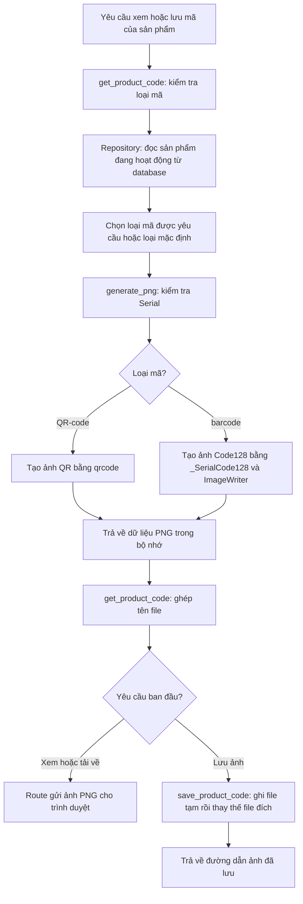

# Giải thích logic sinh ảnh QR-code và barcode

Tài liệu này giải thích file [barcode_service.py](../backend/app/services/barcode_service.py), theo luồng từ dữ liệu sản phẩm đến ảnh PNG. Các đoạn code và ví dụ dưới đây tương ứng với cách triển khai hiện tại.

## 1. Dữ liệu nào được đưa vào mã?

Nội dung của cả QR-code và barcode là trường `product_serial` đã lưu trong database. Ví dụ, với sản phẩm:

```python
product = {
    "id": 7,
    "sku": "SP007",
    "name": "Sữa tươi",
    "product_serial": "00123456",
    "type": "barcode",
}
```

Cả hai loại ảnh đều phải được quét ra chuỗi `"00123456"`. Tên sản phẩm, SKU, giá và số lượng không được đưa vào ảnh mã. Sau khi quét ra Serial, phần tra cứu mới dùng Serial đó để tìm thông tin sản phẩm trong database.

| Thành phần       | Vai trò trong luồng sinh mã                                    |
| ---              | ---                                                            |
| `id`             | Xác định sản phẩm cần đọc và là một phần của tên file ảnh.     |
| `product_serial` | Nội dung được mã hóa thành QR hoặc các vạch Code128.           |
| `type`           | Loại ảnh mặc định khi người gọi không chọn loại mã.            |
| `code_type`      | Tham số cho phép người gọi chọn loại ảnh cho lần tạo hiện tại. |

Serial phải được giữ ở dạng chuỗi. Nếu đổi `"00123456"` thành số nguyên `123456`, hai số 0 ở đầu sẽ bị mất và dữ liệu mã không còn khớp với Serial trong database.

### Serial được cấp ở đâu?

SQL Server cấp Serial khi thêm sản phẩm; `barcode_service.py` sử dụng lại Serial đã được cấp đó.

Trong [SQLQuery1.sql](../database/SQLQuery1.sql), cột `product_serial` có giá trị mặc định được tạo bằng `CRYPT_GEN_RANDOM(4)`, chuyển thành số, lấy phần dư với `100000000`, rồi thêm số 0 bên trái để đủ 8 ký tự. Unique index ngăn hai sản phẩm có cùng Serial.

Hàm `create_product()` trong [product_repository.py](../backend/app/repositories/product_repository.py) bỏ qua cột Serial khi `INSERT`, nên database áp dụng giá trị mặc định. Repository có cơ chế thử lại khi xảy ra xung đột Serial.

Vì vậy, tạo lại ảnh hoặc chọn từ barcode sang QR vẫn sử dụng cùng Serial của sản phẩm.

## 2. Luồng xử lý và trách nhiệm từng hàm



Sơ đồ thể hiện luồng thành công. Nếu dữ liệu không hợp lệ, không tìm thấy sản phẩm hoặc có lỗi đọc/ghi, luồng dừng tại bước gặp lỗi.

| Thành phần trong service | Đầu vào | Kết quả |
| --- | --- | --- |
| `generate_png(serial, code_type)` | Serial và loại mã bắt buộc. | Dữ liệu ảnh PNG kiểu `bytes`. |
| `get_product_code(product_id, code_type=None)` | ID sản phẩm và loại mã tùy chọn. | Tuple `(image, filename)`, gồm dữ liệu PNG và tên file. |
| `save_product_code(product_id, code_type=None)` | ID sản phẩm và loại mã tùy chọn. | Đối tượng `Path` trỏ đến ảnh đã lưu. |
| `_SerialCode128` | Chuỗi Serial được truyền khi khởi tạo. | Kế thừa cách mã hóa Code128, có điều chỉnh bước tối ưu để giữ đúng dữ liệu. |

## 3. `generate_png()`: chuyển Serial thành dữ liệu PNG

Hàm này không truy vấn database. Người gọi truyền Serial vào, hàm kiểm tra dữ liệu rồi tạo ảnh trong bộ nhớ.

### Bước 1: kiểm tra loại mã

```python
CODE_TYPES = ("QR-code", "barcode")

if code_type not in CODE_TYPES:
    raise InvalidProductError("Loại mã phải là QR-code hoặc barcode.")
```

Chỉ hai chuỗi trên được chấp nhận và phải đúng chữ hoa, chữ thường. Ví dụ `"qr"`, `"QR"`, `"EAN8"`, chuỗi rỗng hoặc `None` đều bị từ chối tại hàm này.

Giá trị `"barcode"` trong ứng dụng tương ứng với cách tạo ảnh **Code128**.

### Bước 2: kiểm tra Serial

```python
valid_serial = (
    isinstance(serial, str)
    and len(serial) == 8
    and serial.isascii()
    and serial.isdigit()
)
```

Bốn điều kiện kết hợp bằng `and`:

| Điều kiện | Ý nghĩa |
| --- | --- |
| `isinstance(serial, str)` | Dữ liệu phải là chuỗi, giúp giữ nguyên các số 0 ở đầu. |
| `len(serial) == 8` | Chuỗi phải có đúng 8 ký tự. |
| `serial.isascii()` | Các ký tự phải thuộc bộ ASCII. |
| `serial.isdigit()` | Mọi ký tự đều phải là chữ số. |

Kết hợp `isascii()` và `isdigit()` giới hạn Serial vào các chữ số `0` đến `9`. Riêng `isdigit()` còn chấp nhận một số dạng chữ số Unicode, ví dụ `１２３４５６７８`.

Python kiểm tra từ trái sang phải và dừng ngay khi một điều kiện là `False`. Nếu Serial là `None` hoặc số nguyên, điều kiện đầu tiên sai nên Python không gọi `len()` hay các phương thức chuỗi trên dữ liệu đó.

| Serial đầu vào | Kết quả | Lý do |
| --- | --- | --- |
| `"00123456"` | Hợp lệ. | Đúng 8 chữ số ASCII, giữ số 0 đầu chuỗi. |
| `"00000000"` | Hợp lệ. | Service chấp nhận chuỗi này nếu sản phẩm có Serial như vậy. |
| `"1234567"` | Không hợp lệ. | Thiếu một ký tự. |
| `"123456789"` | Không hợp lệ. | Thừa một ký tự. |
| `"1234abcd"` | Không hợp lệ. | Có chữ cái. |
| `"１２３４５６７８"` | Không hợp lệ. | Chữ số không thuộc ASCII. |
| `" 1234567"` | Không hợp lệ. | Có khoảng trắng; hàm không tự cắt khoảng trắng. |
| `12345678` hoặc `None` | Không hợp lệ. | Không phải chuỗi. |

Nếu kiểm tra thất bại, hàm phát sinh `InvalidProductError` với thông báo Serial phải gồm đúng 8 chữ số. Ảnh chưa được tạo ở thời điểm này.

### Bước 3: chuẩn bị nơi chứa ảnh

```python
output = BytesIO()
```

`BytesIO` là vùng chứa dữ liệu nhị phân trong RAM, có thể ghi vào tương tự một file. Hai nhánh QR và barcode đều ghi ảnh PNG vào `output`.

Nhờ vậy, cùng dữ liệu ảnh có thể được gửi cho trình duyệt hoặc được hàm khác lưu ra ổ đĩa.

### Bước 4A: tạo QR-code

```python
qr = qrcode.QRCode(
    error_correction=qrcode.constants.ERROR_CORRECT_M,
    box_size=10,
    border=4,
)
qr.add_data(serial)
qr.make(fit=True)

image = qr.make_image(fill_color="black", back_color="white")
image.save(output, format="PNG")
```

Các lệnh thực hiện lần lượt:

1. `QRCode(...)` tạo đối tượng cấu hình QR.
2. `add_data(serial)` đưa chuỗi Serial vào làm nội dung cần mã hóa.
3. `make(fit=True)` xây dựng ma trận QR và tự chọn kích thước ma trận đủ chứa dữ liệu.
4. `make_image(...)` chuyển ma trận thành ảnh đen trên nền trắng.
5. `save(output, format="PNG")` ghi ảnh dưới dạng PNG vào bộ nhớ.

| Tham số | Ý nghĩa |
| --- | --- |
| `error_correction=ERROR_CORRECT_M` | Dùng mức sửa lỗi M của QR, bổ sung dữ liệu phục vụ khôi phục khi một phần mã bị hỏng. |
| `box_size=10` | Mỗi ô nhỏ của ma trận QR được vẽ thành khối 10 × 10 pixel. |
| `border=4` | Chừa viền trắng rộng 4 ô quanh ma trận để hỗ trợ nhận diện mã. |
| `fit=True` | Tự chọn kích thước ma trận phù hợp với nội dung. |

`box_size` và `border` điều chỉnh cách hiển thị ảnh. Nội dung quét được vẫn là Serial đã truyền vào.

### Bước 4B: tạo barcode Code128

```python
writer = ImageWriter()
barcode = _SerialCode128(serial, writer=writer)
```

`_SerialCode128` xử lý việc mã hóa chuỗi thành cấu trúc Code128. `ImageWriter` vẽ cấu trúc đó thành ảnh, bao gồm các vạch, khoảng trắng và dòng Serial bên dưới.

Thư viện Code128 xử lý các ký hiệu bắt đầu, dữ liệu, checksum và kết thúc. Service không tự tính checksum hoặc tự vẽ từng vạch.

Sau khi chuẩn bị cấu hình, lệnh sau ghi ảnh vào bộ nhớ:

```python
barcode.write(output, options=options)
```

| Tùy chọn | Giá trị | Ý nghĩa |
| --- | --- | --- |
| `format` | `"PNG"` | Định dạng ảnh đầu ra. |
| `dpi` | `300` | Mật độ dùng khi chuyển kích thước vật lý của mã thành pixel. |
| `module_width` | `0.3` | Độ rộng đơn vị nhỏ nhất của vạch/khoảng trắng, tính bằng mm. |
| `module_height` | `18` | Chiều cao phần vạch, tính bằng mm. |
| `quiet_zone` | `6.5` | Khoảng trắng ở mỗi bên trái và phải của mã, tính bằng mm. |
| `font_size` | `10` | Cỡ chữ của dòng Serial, tính bằng point. |
| `text_distance` | `3` | Tham số khoảng cách đặt dòng chữ bên dưới phần vạch, tính bằng mm. |
| `write_text` | `True` | Hiển thị Serial bằng chữ số bên dưới mã vạch. |

**Vì sao cần lớp `_SerialCode128`?**

```python
class _SerialCode128(Code128):
    def _try_to_optimize(self, encoded):
        return encoded
```

Lớp này kế thừa `Code128` và chỉ ghi đè phương thức `_try_to_optimize()`. Phương thức trả nguyên danh sách ký hiệu đã mã hóa, bỏ qua bước tối ưu cuối của lớp cha.

Trong phiên bản `python-barcode` đang cài ở dự án, bước tối ưu của lớp cha có thể nhầm cặp số `99` ở đầu dữ liệu với ký hiệu chuyển bộ mã. Có thể thấy điều này khi mã hóa Serial `"99001234"`:

```text
Code128 thông thường:  [105,     0, 12, 34]
_SerialCode128:        [105, 99, 0, 12, 34]
```

Đây là danh sách ký hiệu nội bộ trước khi thêm checksum. `105` là ký hiệu bắt đầu bộ C; các giá trị còn lại biểu diễn từng cặp chữ số. Giá trị `0` biểu diễn cặp `00`, nên danh sách thứ hai giữ đủ các cặp `99`, `00`, `12`, `34`.

Việc ghi đè này giữ nguyên dữ liệu trước bước tối ưu có vấn đề. Các bước mã hóa khác, tính checksum và dựng ảnh vẫn do thư viện thực hiện. Khi thay phiên bản thư viện, cần kiểm tra lại các Serial bắt đầu bằng `99` trước khi quyết định bỏ lớp này.

### Bước 5: trả dữ liệu ảnh

```python
return output.getvalue()
```

`getvalue()` lấy toàn bộ dữ liệu PNG dưới dạng `bytes`. Kết quả này là nội dung ảnh, chưa có tên file hay đường dẫn lưu.

Ví dụ gọi riêng hàm tạo ảnh:

```python
image_bytes = generate_png("00123456", "QR-code")
```

## 4. `get_product_code()`: lấy sản phẩm và đặt tên ảnh

Hàm nối việc đọc database với việc tạo ảnh, theo thứ tự sau:

1. **Kiểm tra loại mã do người gọi truyền vào.** Nếu giá trị khác `None`, nó phải là `"QR-code"` hoặc `"barcode"`. Loại sai bị từ chối trước khi truy vấn database.
2. **Đọc sản phẩm.** Gọi `product_repository.get_product_code_data(product_id)`. Repository chỉ chọn sản phẩm có đúng ID và `is_active = 1`.
3. **Xử lý trường hợp không tìm thấy.** Nếu repository trả `None`, phát sinh `ProductNotFoundError`.
4. **Chọn loại mã.** Nếu `code_type is None`, lấy `product["type"]` làm mặc định. Nếu đã truyền loại hợp lệ, dùng loại được yêu cầu.
5. **Tạo ảnh.** Lấy `product["product_serial"]` rồi gọi `generate_png(serial, code_type)`. Serial và loại mã cuối cùng được kiểm tra tại hàm tạo ảnh.
6. **Đặt tên file.** Chọn hậu tố `qr` hoặc `barcode`, rồi ghép ID và Serial.
7. **Trả về** tuple `(image, filename)`.

Tên file tuân theo mẫu:

```text
product-{id}-{serial}-{suffix}.png
```

Với sản phẩm mẫu ở đầu tài liệu:

| Lời gọi | Loại ảnh được tạo | Tên file |
| --- | --- | --- |
| `get_product_code(7)` | Barcode, theo `type` trong database. | `product-7-00123456-barcode.png` |
| `get_product_code(7, "QR-code")` | QR, theo yêu cầu. | `product-7-00123456-qr.png` |
| `get_product_code(7, "barcode")` | Barcode, theo yêu cầu. | `product-7-00123456-barcode.png` |

Chỉ `None` có nghĩa là dùng loại mặc định. Chuỗi rỗng `""` bị coi là loại mã không hợp lệ.

Hàm này đọc dữ liệu sản phẩm và trả ảnh trong bộ nhớ; nó không cập nhật `product_serial` hay `type` trong database.

## 5. `save_product_code()`: lưu ảnh ra ổ đĩa

Hàm gọi `get_product_code()` trước để nhận ảnh và tên file. Sau đó mới chuẩn bị thư mục và ghi ảnh.

### Bước 1: xác định đường dẫn

Nếu tên file kết thúc bằng `-qr.png`, chọn thư mục `QR`; các ảnh barcode chọn thư mục `Barcode`.

```python
image_directory = Path(current_app.config["PRODUCT_IMAGE_DIR"])
directory = image_directory / folder
directory.mkdir(parents=True, exist_ok=True)
destination = directory / filename
```

`PRODUCT_IMAGE_DIR` mặc định được cấu hình là thư mục `img` ở gốc dự án trong [app/__init__.py](../backend/app/__init__.py). Với cấu hình đó, hai đường dẫn của sản phẩm mẫu là:

```text
ProductManagement/img/QR/product-7-00123456-qr.png
ProductManagement/img/Barcode/product-7-00123456-barcode.png
```

`mkdir(parents=True, exist_ok=True)` tạo cả các thư mục cha còn thiếu và chấp nhận thư mục đã tồn tại.

`current_app` lấy cấu hình của ứng dụng Flask đang hoạt động. Khi gọi riêng hàm lưu từ một script, cần đặt lời gọi trong application context của Flask, chẳng hạn `with app.app_context():`.

### Bước 2: ghi vào file tạm

```python
with NamedTemporaryFile(
    dir=directory,
    prefix=".product-code-",
    suffix=".tmp",
    delete=False,
) as temporary:
    temporary_path = Path(temporary.name)
    temporary.write(image)
```

File tạm được tạo ngay trong thư mục đích, có tên riêng do thư viện cấp, ví dụ `.product-code-abc123.tmp`.

`temporary.write(image)` ghi dữ liệu PNG vào file này. Khi ra khỏi khối `with`, file được đóng. `delete=False` giữ lại file sau khi đóng để bước tiếp theo có thể đổi nó thành file đích.

### Bước 3: thay thế ảnh đích

```python
temporary_path.replace(destination)
```

Sau khi file tạm đã ghi xong và đóng, `replace()` chuyển nó thành tên file đích. Nếu ảnh đích đã tồn tại, ảnh được thay thế. Đóng file trước thao tác này giúp tránh lỗi do file đang mở trên Windows.

Cách ghi này giữ ảnh cũ trong lúc đang tạo file mới. Nếu ghi file tạm hoặc thao tác thay thế thất bại, hàm phát sinh lỗi thay vì ghi dở trực tiếp lên ảnh đích.

Lưu lại cùng sản phẩm và cùng loại mã tạo ra cùng tên file, nên ảnh được cập nhật tại đường dẫn cũ. Hai loại mã có hậu tố và thư mục khác nhau nên có thể lưu cả hai.

### Bước 4: dọn file tạm

```python
finally:
    if temporary_path is not None:
        temporary_path.unlink(missing_ok=True)
```

`finally` chạy sau khối `try`, kể cả khi ghi hoặc thay thế file gặp lỗi. Nếu đã có đường dẫn file tạm, chương trình yêu cầu xóa file đó.

Khi thay thế thành công, file tạm đã được chuyển thành file đích và tên tạm không còn tồn tại. `missing_ok=True` cho phép bỏ qua trường hợp này. Thao tác dọn chỉ dùng đường dẫn tạm nên không xóa ảnh đích.

Nếu hệ điều hành từ chối cả thao tác xóa, lỗi vẫn có thể phát sinh và file tạm có thể còn lại; `finally` bảo đảm có bước thử dọn, không bảo đảm vượt qua mọi lỗi hệ thống file.

Khi hoàn tất, hàm trả `destination` dưới dạng `Path`. Đây là đường dẫn đến ảnh đã lưu, khác với dữ liệu `bytes` mà `generate_png()` trả về.

## 6. Service được API sử dụng thế nào?

[routes/barcodes.py](../backend/app/routes/barcodes.py) nhận yêu cầu HTTP và gọi service:

| Yêu cầu | Hàm service được gọi | Kết quả |
| --- | --- | --- |
| `GET /api/products/7/code` | `get_product_code(7, None)` | Gửi ảnh PNG theo loại mặc định cho trình duyệt. |
| `GET /api/products/7/code?type=QR-code` | `get_product_code(7, "QR-code")` | Gửi ảnh QR cho trình duyệt. |
| `GET /api/products/7/code?type=barcode&download=1` | `get_product_code(7, "barcode")` | Gửi PNG kèm chỉ dẫn tải xuống qua `send_file()`. |
| `POST /api/products/7/code` với JSON `{"type": "QR-code"}` | `save_product_code(7, "QR-code")` | Lưu ảnh tại backend rồi trả JSON chứa tên file và đường dẫn. |
| `POST /api/products/7/code` với JSON `{}` | `save_product_code(7, None)` | Lưu ảnh theo loại mặc định trong database. |

Trong luồng GET, ảnh được tạo trong bộ nhớ và gửi đi. Trong luồng POST, ảnh được ghi vào thư mục do backend cấu hình. Tham số `download=1` thuộc phần gửi HTTP ở route, không thay đổi nội dung mã.

Các lỗi được chuyển thành phản hồi HTTP tại route hoặc [errors.py](../backend/app/errors.py):

| Tình huống | Nơi phát sinh/xử lý | HTTP |
| --- | --- | --- |
| Loại mã hoặc Serial không hợp lệ. | Service phát sinh `InvalidProductError`; error handler trả JSON. | `400` |
| Sản phẩm không tồn tại hoặc đã ngừng hoạt động. | Service phát sinh `ProductNotFoundError`; error handler trả JSON. | `404` |
| JSON gửi để lưu mã không phải một đối tượng hợp lệ. | Route kiểm tra trước khi gọi service. | `400` |
| Không truy cập được database. | Lỗi database được error handler xử lý. | `503` |
| Có `OSError` khi tạo thư mục, ghi, thay thế hoặc dọn file. | Route lưu mã bắt lỗi và trả thông báo lưu ảnh thất bại. | `500` |

## 7. Kiểm tra logic bằng bộ kiểm thử hiện có

File [test_barcodes.py](../backend/tests/test_barcodes.py) kiểm tra các hành vi liên quan:

- Tạo cả QR và Code128, giải mã ảnh để đối chiếu Serial gốc, gồm các trường hợp có số 0 đầu chuỗi và bắt đầu bằng `99`.
- Từ chối Serial sai kiểu, sai độ dài, có ký tự không hợp lệ hoặc loại mã không được hỗ trợ.
- Dùng loại mặc định hoặc loại được yêu cầu; đặt đúng tên ảnh và không thay đổi dữ liệu sản phẩm.
- Trả lỗi khi không tìm thấy sản phẩm hoặc không truy cập được database.
- Lưu đúng thư mục, lưu lại cùng tên file và giữ ảnh cũ khi mô phỏng lỗi thay thế file.

Từ thư mục `backend`, chạy:

```powershell
.\.venv\Scripts\python.exe -m unittest discover -s tests -p test_barcodes.py -v
```

Các truy vấn database trong bộ kiểm thử này được giả lập. Phần giải mã ảnh cần ZBar/pyzbar hoạt động; kiểm thử giải mã chuyên biệt được bỏ qua nếu bộ giải mã không khả dụng.
